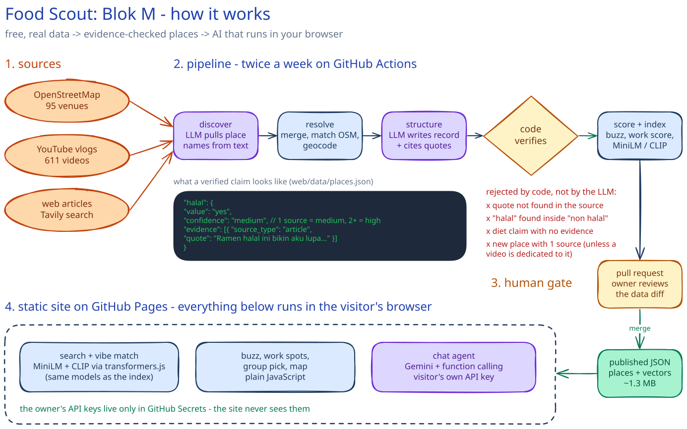
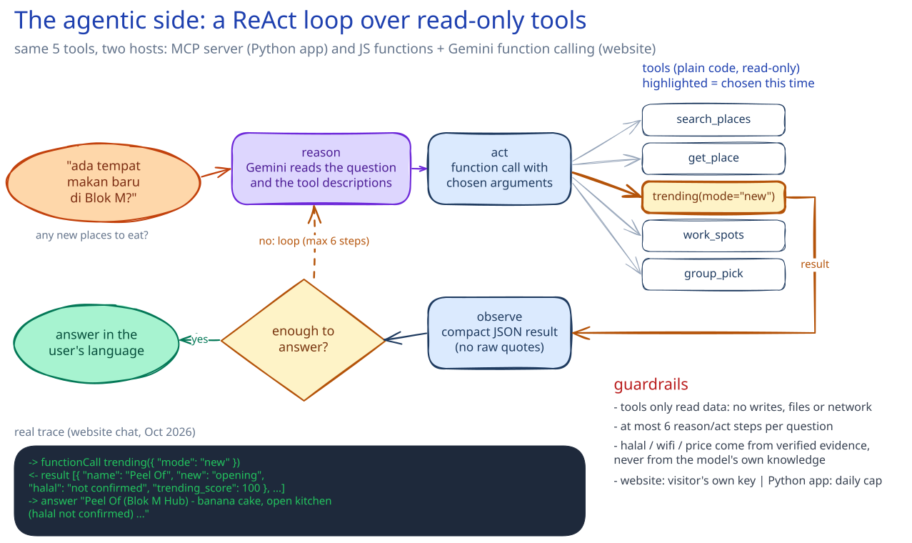

# 🍜 Food Scout: Blok M

**▶ Live demo: [rifqihafizuddin.github.io/blokm-agent](https://rifqihafizuddin.github.io/blokm-agent/)**: no install, runs in your browser.

An **agentic, multimodal food guide** for Blok M, Jakarta, built entirely on **free, real data**.
Ask in plain language ("ramen halal yang enak", "cozy cafe for nugas under 50k"), upload a photo to find
places with the same vibe, let a group settle on one spot, and see what's trending right now.

Every claim about a place (halal, wifi, power outlets, price) links to the **quote and source** it came from,
with a confidence level, so the app never presents a guess as a fact.

## What it does

| Feature | How |
|---|---|
| 💬 **Chat** | A ReAct agent (Gemini 3.5 Flash Lite) that calls five read-only tools; see the [technical report](#agentic-design-a-mini-technical-report) |
| 📸 **Vibe Match** | CLIP image-to-image search over real place photos, optionally blended with a text hint |
| 👥 **Group Pick** | Hard rules (halal, vegetarian, budget) for everyone, then the place where the *least-happy* member is happiest (maximin) |
| 🔥 **Buzz** | Three separate views: **Trending now** (momentum: views per day on videos from the last 60 days + past-month articles), **New spots** (a source says it just opened, with the quote, or first mentioned in the last 120 days), and all-time **Favorites** |
| 💻 **Work Spots** | Work-from-cafe score from wifi, outlets, quiet and long-stay evidence |
| 🗺️ **Map** | Every located place on OpenStreetMap, sized by buzz |

## Data (refreshed 2026-10-22)

| | |
|---|---|
| Places | **194**: 95 from OpenStreetMap + 99 discovered in vlogs and articles (16 of them from a video dedicated to that place). OSM alone had 83 named venues in the area. |
| Sources | 611 YouTube videos · 84 articles + 200 targeted web searches · 383 viewer comments · 122 thumbnails |
| Evidence-backed signals | halal 22 (all high or medium confidence) · long-stay 14 · quiet 13 · wifi 10 · outlets 5 · price 28 places |
| Buzz | 70 places with momentum in the last 60 days · 16 confirmed new openings (with quotes) · 22 newly spotted |

## How it works



The live demo is a **static site on GitHub Pages** (`web/`). There's no backend:
- **Search and Vibe Match run in the visitor's browser**: MiniLM and CLIP via [transformers.js](https://github.com/huggingface/transformers.js),
  the same models used to build the index, so browser vectors match the Python ones
  (identical to 5 decimals for text; 0.99 cosine for photos).
- **Buzz, Work Spots, Group Pick and Map** are computed from `web/data/*.json` in JavaScript.
- **Chat** calls Gemini with the visitor's **own free API key** (kept only for the browser tab) and uses the same tool functions.
- **A GitHub Action** (`.github/workflows/refresh.yml`) reruns the pipeline twice a week and opens a **pull request**
  with the new data. Nothing reaches the site until the owner reviews and merges it.

The full Python app (FastMCP server + ReAct agent + Gradio) is in `app/` for running locally.

Pipeline steps (`pipeline/`): `seed_osm` → `discover` → `resolve` → `collect` → `enrich` → `structure` → `photos`
→ `score` → `index` → `export_web`.

**Freshness.** Discovery runs both relevance-sorted searches (the classics) and newest-first searches over
the last 120 days, so "trending now" reflects current momentum rather than last year's mega-hit.

**Staying free.** Nearly all LLM work happens once, offline, and every API response is cached. The tools are
deterministic, so a chat turn costs only 2-4 LLM calls. When every LLM's quota runs out, the Python chat falls
back to a plain search instead of failing.

## Agentic design: a mini technical report



**1. The agent picks tools; the tools do the work.** The five tools (`search_places`, `get_place`, `trending`,
`work_spots`, `group_pick`) are deterministic code over the published data. The LLM never writes a halal label,
a score or a ranking; it only chooses a tool and its arguments, then explains the result. This keeps answers
grounded and makes every tool unit-testable.

**2. Tool descriptions are the router.** Routing quality comes from the descriptions, not from extra prompting.
For example, `trending` documents its three modes (`now` = momentum in the last 60 days, `new` = just opened or
newly spotted, `favorites` = all-time), so *"ada tempat makan baru?"* reliably becomes `trending(mode="new")`
instead of returning last year's hits.

**3. One design, two hosts.** In the Python app, the tools live in a **FastMCP server** and the ReAct agent
discovers them at runtime over MCP (in-memory transport, so models load once). On the website, the same five
tools are JavaScript functions exposed to Gemini through native function calling.

**4. Group Pick is deliberately not an LLM negotiation.** Hard rules (halal, vegetarian, budget) filter for
everyone; each place is then scored per member against what they want (MiniLM similarity, min-max normalised),
and places are ranked by the **least-happy member's score** (maximin). The LLM only explains the trade-off.
Same behaviour as one "advocate" agent per member, at a fraction of the LLM calls.

**5. Grounding, enforced by code.** In the pipeline, the LLM must cite a source for every claim. Code then:
- keeps a place name only if it appears in the source text, and a quote only if it is verbatim;
- rejects a "halal: yes" quote that sits inside "non halal" / "tidak halal" or mentions pork;
- refuses diet claims (halal, vegetarian) without evidence, and treats anonymous comments alone as *low*;
- sets confidence by rule: **high** = OSM tag or 2+ independent sources, **medium** = 1, **low** = inferred
  (filters only accept high or medium);
- publishes a place that isn't in OpenStreetMap only with 2+ independent sources, or with one YouTube video
  dedicated to it (the only place in the video, and named in its title); one line in a "23 spots" list isn't enough.

**6. Guardrails.** Tools are read-only (no writes, files or network). The agent gets at most 6 reason/act steps
per question and compact tool results. The Python app caps LLM calls per day, truncates history and input, and
only lets the UI (not the LLM) call the photo tool, which accepts uploaded files only.

**Evaluation.** 18 automated tests run the tools through the MCP protocol with no LLM calls: ranking order,
filters, evidence on every non-low claim, maximin correctness, photo self-match (>0.95), and the security rules
above. Browser and Python embeddings were checked for parity, and the agent was spot-checked on real
English and Indonesian questions.

## Run the Python app locally

```bash
python -m venv .venv && .venv/Scripts/pip install -r requirements.txt   # Windows; use .venv/bin on macOS/Linux
# Linux / CI, fully hash-locked: pip install --require-hashes --no-deps -r requirements-lock.txt --extra-index-url https://download.pytorch.org/whl/cpu
cp .env.example .env    # add GEMINI_API_KEY and GROQ_API_KEY (YouTube/Tavily keys are only needed to rebuild data)
python app/ui.py
```

Rebuild the data: `cd pipeline && python seed_osm.py && python discover.py && python resolve.py && python collect.py && python enrich.py && python structure.py && python photos.py && python score.py && python index.py && python export_web.py`

Static site locally: `cd web && python -m http.server` then open http://localhost:8000

Tests: `python -m pytest tests` (18 tool and security tests, no LLM calls).

The MCP server also runs on its own (`python app/server.py`), for use from any MCP client such as Claude Desktop.

## Security

An independent review (Oct 2026) found no leaked keys in the code, history or published site. Hardening applied:
- **Keys:** the owner's keys exist only as encrypted GitHub Secrets, visible only to the pipeline step; the site
  never uses them. YouTube's key is sent in a header, never in URLs.
- **CI supply chain:** dependencies are installed from a hash-locked file (`requirements-lock.txt`, `uv`, with
  PyTorch alone from its own index); actions are pinned to commit SHAs; no git credentials are stored while
  third-party code runs; new Tavily searches are capped per run.
- **Data integrity / prompt injection:** grounded extraction, verbatim-quote checks, the two-source rule for new
  places (or one dedicated video), length and link stripping on all LLM text, and a human-reviewed pull request before publishing.
- **Website:** all third-party text is HTML-escaped and links are limited to `https://`; a Content-Security-Policy
  restricts scripts and connections; CDN files are pinned with Subresource Integrity (Leaflet) or an import-map
  integrity hash (transformers.js); a visitor's Gemini key stays in `sessionStorage` and is sent only to Google.

## Limitations

- Signals come from public mentions and can be wrong or outdated. **Check halal status at the venue.**
- Many small places have little or no evidence; they show "not confirmed" rather than a guess.
- Prices are only shown when a source states them.
- Coverage is Blok M only (Melawai / Little Tokyo, Blok M Square, M Bloc, Bulungan, Panglima Polim).

## Attribution

Map data © [OpenStreetMap](https://www.openstreetmap.org/copyright) contributors (ODbL) · video data via the
YouTube Data API · web search via Tavily · LLMs: Google Gemini, Groq · embeddings: MiniLM, OpenAI CLIP.

Built as a portfolio follow-up to the IBM RAG and Agentic AI Professional Certificate.
